# SecIncident — incidents de sécurité pour GLPI 11 (v1.9.0)

Plugin GLPI (11.0.x) pour déclarer, qualifier et tracer les incidents de sécurité, avec import des exports CSV de votre EDR / XDR. Interface en français et en anglais, ouverte à d'autres langues.

> **English** — GLPI 11 plugin to report, qualify and track security incidents: structured timeline and investigation actions, IOCs, remediation playbooks, response team, SHA-256 sealed evidence and data, tamper-evident audit trail, GDPR / NIS2 deadlines, MITRE ATT&CK, EDR / XDR CSV import. Available in English and French; see [Translations](#langues--translations).

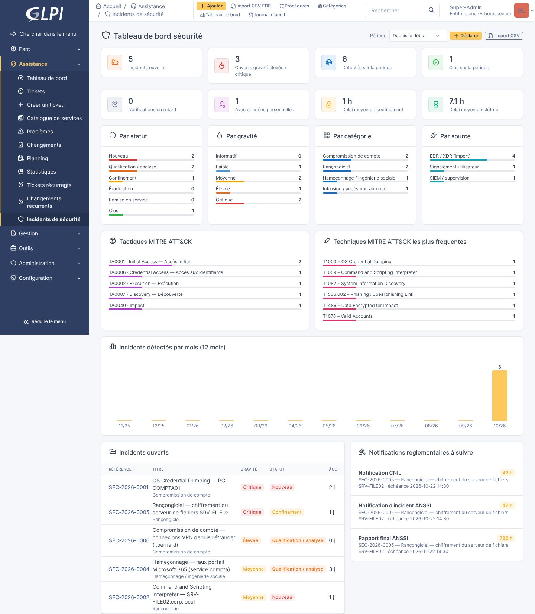

## Captures

| | |
|---|---|
| 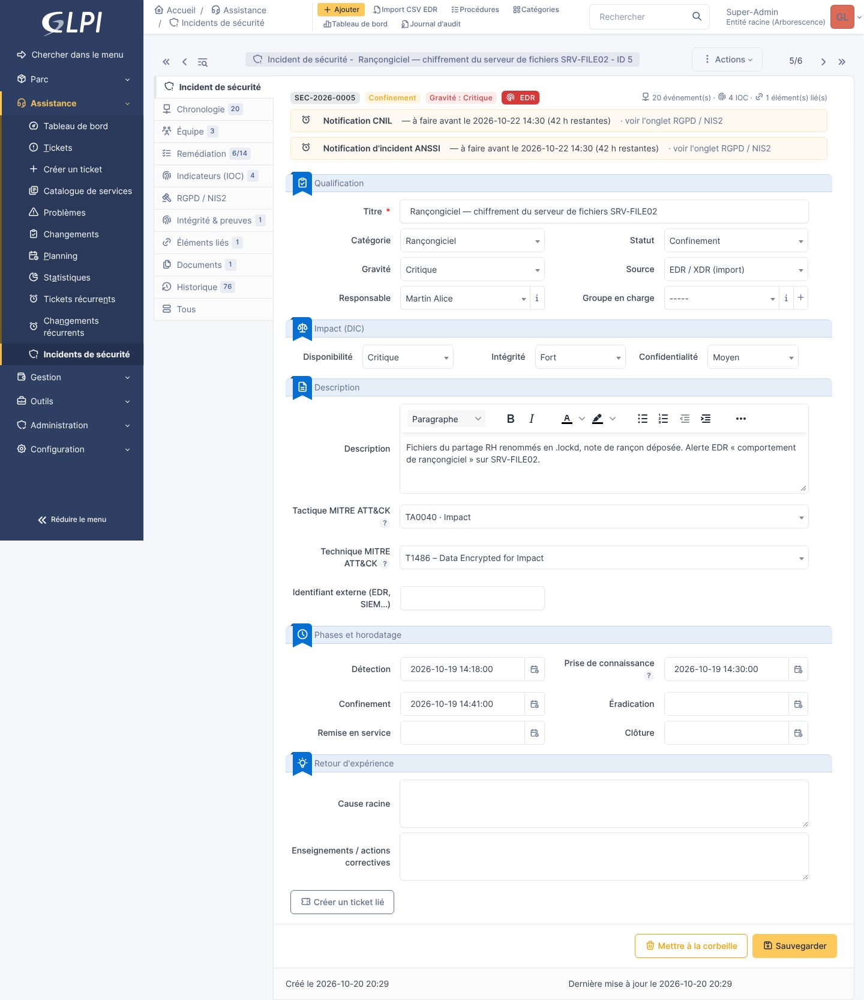 | 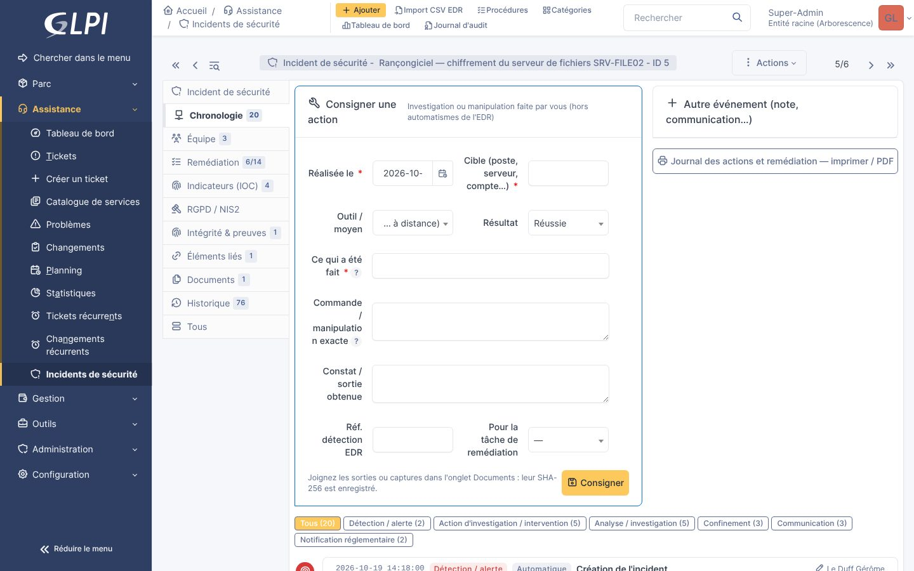 |
| 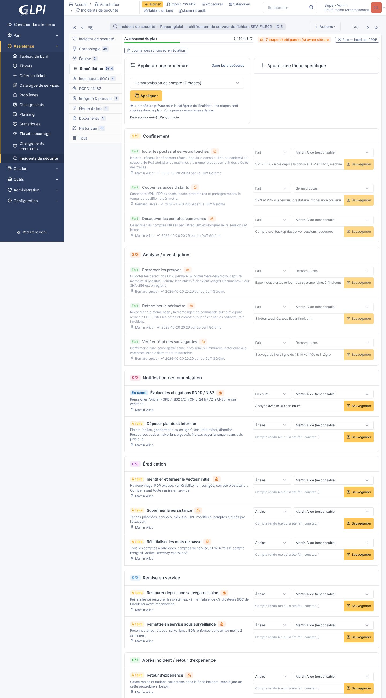 | 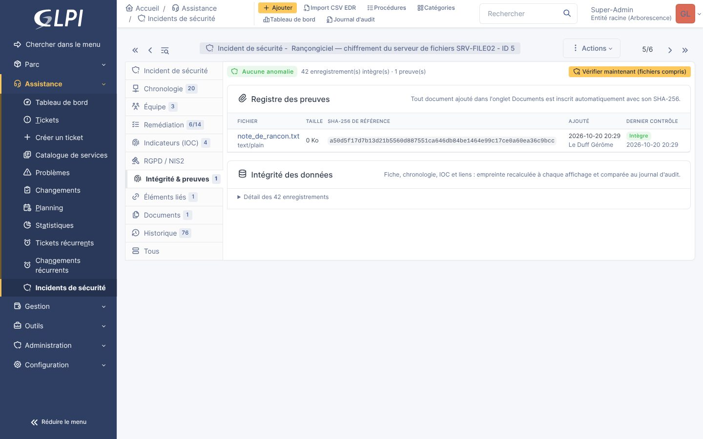 |
| 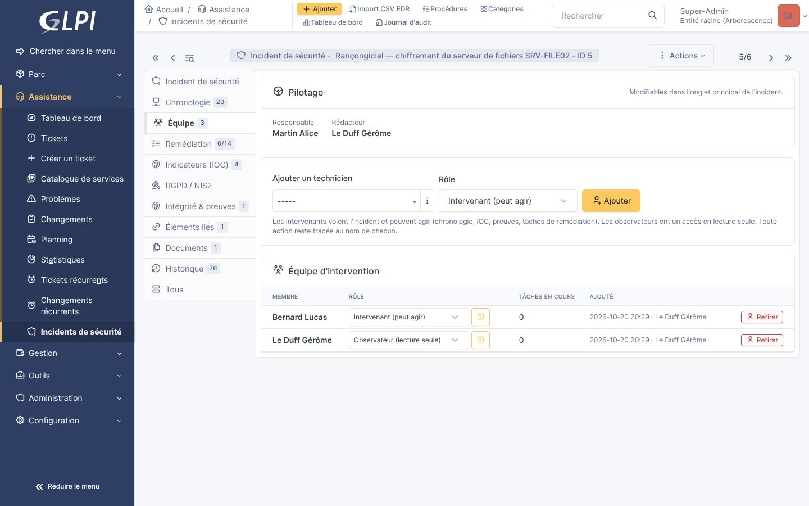 | 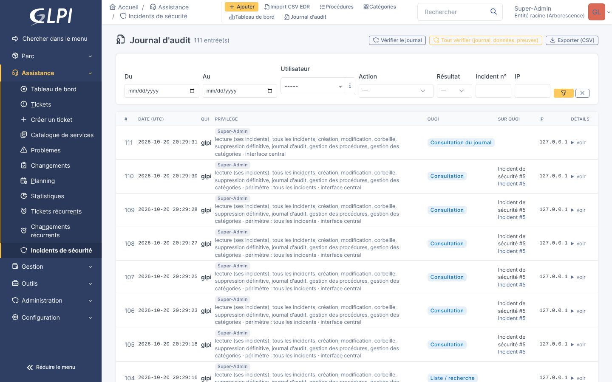 |
| 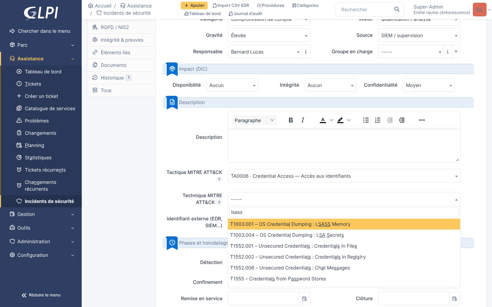 | 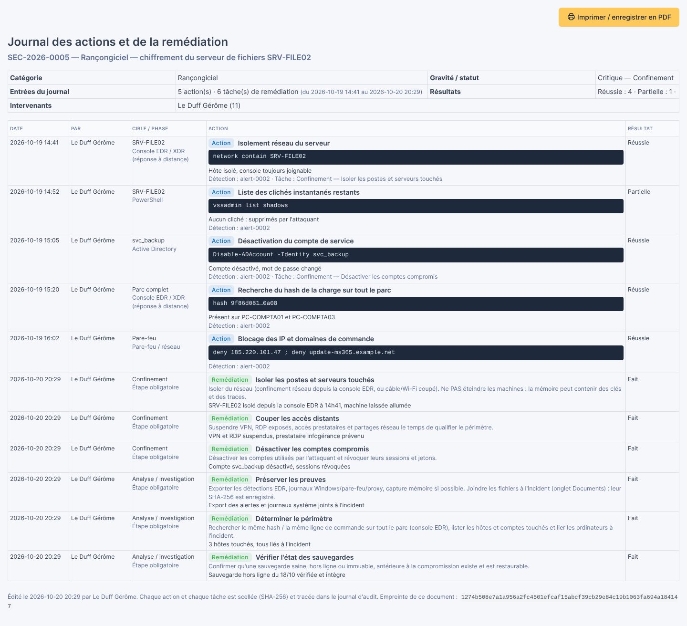 |
| 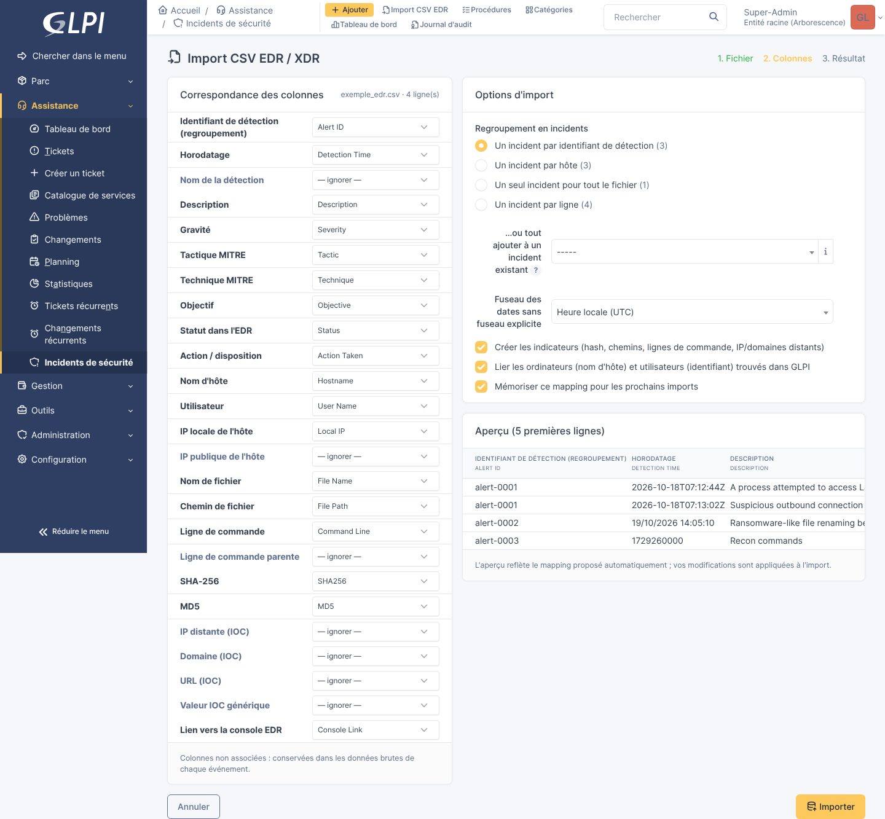 | 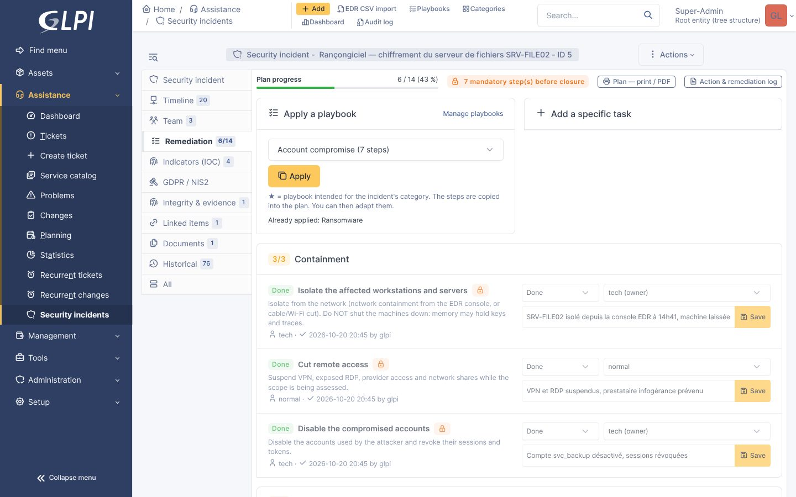 |

## Fonctionnalités

- **Objet « Incident de sécurité »** distinct des tickets (menu Assistance), référence auto `SEC-AAAA-0001`, entités et sous-entités, historique GLPI, documents joints.
- **Qualification** : catégorie paramétrable (rançongiciel, hameçonnage, compromission de compte, fuite de données… et les vôtres), gravité 1–5, impact DIC, statut calé sur les phases NIST (nouveau → qualification → confinement → éradication → remise en service → clos), tactique / technique MITRE ATT&CK (listes du référentiel officiel, voir plus bas), responsable et groupe.
- **Actions d'investigation** : chaque manipulation faite par l'équipe est consignée de façon structurée (cible, outil, commande exacte, résultat, détection liée) et imprimable en journal des actions (voir plus bas).
- **Chronologie** : frise filtrable par type d'événement. Les changements de statut, notifications réglementaires et créations de ticket y sont ajoutés automatiquement. Les données brutes importées sont conservées telles quelles et ne sont pas modifiables.
- **Indicateurs (IOC)** : saisie en masse (une valeur par ligne, type détecté automatiquement), dédoublonnage, verdict, première / dernière vue, liens de recherche VirusTotal / AbuseIPDB / urlscan.
- **Éléments liés** : tickets, problèmes, changements, ordinateurs, matériels réseau, logiciels, utilisateurs, fournisseurs. Un onglet « Incidents de sécurité » apparaît sur ces éléments, avec un bouton pour déclarer un incident déjà lié. Création d'un ticket lié en un clic.
- **RGPD / NIS2** : violation de données personnelles (risque, personnes concernées, justification pour le registre), notification CNIL 72 h, information des personnes, alerte précoce ANSSI 24 h, notification 72 h, rapport final 1 mois. Échéances calculées depuis la date de prise de connaissance, alertes dans la fiche et dans le tableau de bord.
- **Tableau de bord** : incidents ouverts, critiques, délais moyens de confinement et de clôture, répartitions cliquables (vers la recherche), tendance sur 12 mois, notifications à suivre.
- **Import CSV d'EDR / XDR** (voir plus bas).
- **Procédures de remédiation** : bibliothèque de procédures types, appliquées à un incident sous forme de plan de tâches à suivre (voir plus bas).
- **Équipe d'intervention** : plusieurs techniciens par incident, avec répartition des tâches (voir plus bas).
- **Cloisonnement** : un technicien ne voit et ne modifie que ses incidents (voir plus bas).
- **Journal d'audit infalsifiable** : qui, quoi, sur quoi, avec quel privilège, depuis quelle IP (voir plus bas).
- **Intégrité des preuves et des données** : SHA-256 sur chaque fichier de preuve et chaque enregistrement, vérifiable à tout moment (voir plus bas).

## Installation

1. Copier le dossier `secincident` dans `glpi/plugins/` (ou `marketplace/`).
2. Configuration > Plugins > installer puis activer « Incidents de sécurité ».
   En ligne de commande :
   ```
   php bin/console plugin:install secincident --username=glpi
   php bin/console plugin:activate secincident
   ```
3. Administration > Profils > onglet « Incidents de sécurité » pour donner les droits.
   À l'installation, seuls les profils ayant le droit de modifier la configuration (Super-Admin) reçoivent tous les droits.

Prérequis : GLPI 11.0.x, PHP 8.2+.

## Droits et cloisonnement

Administration > Profils > onglet « Incidents de sécurité » :

| Droit | Effet |
|---|---|
| Voir ses incidents | accès aux seuls incidents dont on est **responsable**, **rédacteur**, membre du **groupe en charge** ou de l'**équipe d'intervention** |
| Voir et gérer tous les incidents | lève le cloisonnement (RSSI, responsable sécurité) |
| Créer / Modifier / Corbeille / Supprimer définitivement | s'appliquent uniquement au périmètre visible |
| Journal d'audit | accès à la page du journal |
| Gérer les procédures | créer, modifier et supprimer les procédures de remédiation et leurs étapes |
| Gérer les catégories | créer, renommer et supprimer les catégories d'incident |

Le cloisonnement est appliqué partout : liste et recherche, exports de la liste, listes déroulantes, API, tableau de bord, onglets sur tickets / ordinateurs, chronologie, IOC, éléments liés, import CSV (une détection déjà rattachée à l'incident d'un autre technicien n'est ni complétée ni révélée). Accès direct par URL ou par onglet : refusé et tracé.

Un technicien sans « tous les incidents » devient automatiquement responsable des incidents qu'il crée. Le rédacteur est toujours l'utilisateur connecté et ne peut pas être modifié.

À l'installation, seuls les profils administrant la configuration (Super-Admin) reçoivent tous les droits. Conseil : Technicien = Voir ses incidents + Créer + Modifier ; RSSI = tous les droits. Sans « Gérer les procédures » / « Gérer les catégories », un profil voit les listes en lecture seule ; toute tentative de création ou de modification (même par requête forgée) est refusée et tracée dans le journal d'audit.

### Catégories d'incident

Menu Assistance > Incidents de sécurité > **Catégories**. Chaque catégorie a un libellé (modifiable) et un code interne généré à la création (non modifiable) : c'est le code qui est enregistré dans les incidents, donc renommer une catégorie ne touche à aucune donnée scellée. Une catégorie utilisée par un incident ou une procédure ne peut pas être supprimée (renommez-la), et « Autre » sert de repli. Les procédures peuvent être rattachées aux nouvelles catégories.

## MITRE ATT&CK

La fiche incident propose les **15 tactiques** d'ATT&CK Enterprise (v20 : « Defense Evasion » y est remplacée par « Stealth » et « Defense Impairment ») et les **706 techniques et sous-techniques** dans une liste avec recherche : tapez un identifiant (`T1566`) ou un mot-clé (`phishing`, `lsass`).

- Choisir une tactique filtre la liste des techniques ; choisir une technique propre à une seule tactique remplit la tactique.
- Enregistré : le nom officiel de la tactique (« Credential Access ») et « Txxxx – Nom » pour la technique. Les saisies `TA0006`, `t1003.001`, le nom seul, le nom français ou l'ancien « Defense Evasion » sont ramenés à la valeur officielle, y compris à l'import CSV d'EDR et par l'API.
- Une ancienne valeur libre non reconnue est conservée et affichée « hors référentiel ».
- Le tableau de bord affiche la répartition par tactique et les techniques les plus fréquentes (cliquables vers la recherche).

Référentiel embarqué : `data/mitre_attack.json`, généré depuis [attack-stix-data](https://github.com/mitre-attack/attack-stix-data). © The MITRE Corporation. This work is reproduced and distributed with the permission of The MITRE Corporation.

## Journal d'audit

Menu Incidents de sécurité > **Journal d'audit** (droit « Journal d'audit »).

Chaque entrée contient :
- **qui** : utilisateur, et l'utilisateur réel en cas de « Prendre l'identité » ;
- **avec quel privilège** : profil actif, droits du plugin, périmètre (tous les incidents / ses incidents et à quel titre / hors périmètre) ;
- **quoi** : consultation (fiche, chronologie, IOC, RGPD/NIS2, historique, documents, liste, tableau de bord), création, modification (champ par champ, avant → après), corbeille, restauration, suppression, liaison, import (fichier + SHA-256 + statistiques), création de ticket, changement de droits sur un profil, accès refusé ;
- **sur quoi** : type et identifiant de l'objet, incident concerné ;
- **d'où** : adresse IP, date UTC.

Intégrité : les entrées sont chaînées (SHA-256 de l'entrée précédente + contenu). Le bouton « Vérifier l'intégrité » rejoue la chaîne et signale la première entrée modifiée ou supprimée directement en base. Aucune interface ne permet de modifier le journal. Filtres (date, utilisateur, action, résultat, incident, IP) et export CSV, eux-mêmes tracés.

Le journal est **conservé à la désinstallation** (valeur probante). Pour le supprimer volontairement : `DROP TABLE glpi_plugin_secincident_auditlogs;`.

Limites à connaître :
- un administrateur base de données peut toujours modifier la table : il ne peut pas le faire **sans que ce soit détecté**, sauf à recalculer toute la chaîne. Pour une preuve opposable, exporter régulièrement le journal (ou sa dernière empreinte) vers un stockage externe en écriture seule ;
- si l'écriture d'une entrée échoue (base indisponible), l'action n'est pas bloquée ; l'échec est consigné dans `files/_log/php-errors.log` ;
- les actions faites directement en SQL ou via d'autres plugins ne passent pas par le journal.

## Actions d'investigation et d'intervention

L'EDR trace ce qu'il détecte et bloque. Le plugin trace **ce que l'équipe fait elle-même**.

Dans l'onglet **« Chronologie »**, le formulaire **« Consigner une action »** enregistre :
- la date et l'auteur (automatique, non falsifiable) ;
- la **cible** (poste, serveur, compte…) : obligatoire ;
- l'**outil** utilisé : console EDR / XDR (réponse à distance), PowerShell, Active Directory, Microsoft 365, pare-feu, sauvegarde, analyse forensic, intervention physique… ;
- ce qui a été fait, et la **commande ou manipulation exacte**, pour pouvoir la refaire ou l'annuler ;
- le **résultat** : réussie, partielle, échec, à vérifier ;
- le constat ou la sortie obtenue ;
- la référence de la **détection EDR** et la **tâche de remédiation** concernées.

Les sorties de commandes, captures et journaux se joignent dans l'onglet Documents, avec leur SHA-256.

Bouton **« Journal des actions et remédiation — imprimer / PDF »** : synthèse (nombre d'actions, période, résultats, intervenants) puis toutes les actions dans l'ordre chronologique, avec l'empreinte SHA-256 du document. L'impression est tracée.

## Équipe d'intervention

Onglet **« Équipe »** de chaque incident. Le responsable, le rédacteur, le groupe en charge (ou un profil « tous les incidents ») peuvent ajouter des techniciens :

| Rôle | Peut |
|---|---|
| Intervenant | voir l'incident et agir : chronologie, IOC, preuves, RGPD/NIS2, tâches de remédiation |
| Observateur | consulter en lecture seule |

- Seuls les **pilotes** (responsable, rédacteur, groupe en charge, RSSI) composent l'équipe, mettent l'incident à la corbeille ou le suppriment.
- Les tâches de remédiation se **répartissent entre les membres** (sélecteur sur chaque tâche). Confier une tâche à quelqu'un hors équipe l'ajoute automatiquement comme intervenant si c'est un pilote qui le fait ; sinon c'est refusé.
- Chaque technicien retrouve **« Mes tâches de remédiation »** en haut du tableau de bord.
- Retirer quelqu'un de l'équipe lui coupe immédiatement l'accès (sauf s'il y a accès à un autre titre).
- Ajouts, retraits et changements de rôle sont tracés dans la chronologie et le journal d'audit, et scellés. Chaque action reste enregistrée au nom de la personne qui l'a faite, avec son rôle (« périmètre : ses incidents (intervenant) »).

Un membre doit avoir au minimum le droit « Voir ses incidents » sur son profil pour accéder au plugin.

## Procédures de remédiation

Menu Incidents de sécurité > **Procédures** : bibliothèque de procédures types (playbooks). Chaque procédure a une catégorie d'incident et des étapes ordonnées par phase (confinement, analyse, notification, éradication, remise en service, après incident), avec instructions et caractère obligatoire.

Cinq procédures sont fournies à l'installation, modifiables : rançongiciel, hameçonnage, compromission de compte, logiciel malveillant, fuite de données.

Dans l'onglet **« Remédiation »** d'un incident :
- appliquer une procédure (celles de la catégorie de l'incident sont proposées en premier, marquées ★) : ses étapes sont copiées dans le plan de l'incident et peuvent ensuite être adaptées ;
- ajouter des tâches spécifiques à l'incident ;
- suivre chaque tâche : statut (à faire, en cours, fait, non applicable), compte rendu, assignation ; la réalisation est horodatée et signée (qui, quand) et inscrite dans la chronologie ;
- **clôture bloquée** tant qu'une étape obligatoire n'est ni faite ni marquée « non applicable » ;
- **impression / PDF** du plan avec cases à cocher, comptes rendus, zones de signature et empreinte SHA-256 du plan à la date d'impression (l'impression est tracée avec cette empreinte).

Les tâches sont cloisonnées, auditées et scellées comme le reste des données de l'incident.

Qui fait quoi :

| | Gérer les procédures (Super-Admin, RSSI) | Intervenant (droit de modifier l'incident) |
|---|---|---|
| Créer / modifier la bibliothèque de procédures | oui | non |
| Appliquer une procédure validée à l'incident | oui | oui |
| Ajouter une tâche spécifique au plan, la supprimer | oui | non |
| Modifier la définition d'une tâche (action, instructions, phase, obligatoire, ordre) | oui | non (refus tracé) |
| Renseigner statut, assignation et compte rendu | oui | oui |

Toute tâche réalisée ou jugée non applicable apparaît dans le **journal des actions et de la remédiation** téléchargeable (date, auteur, phase, compte rendu), même si aucune action détaillée n'a été consignée en parallèle. Le journal est accessible depuis la chronologie et depuis l'onglet Remédiation.

## Intégrité des preuves et des données

Onglet **« Intégrité & preuves »** de chaque incident.

**Preuves (fichiers)** : tout document joint à un incident (onglet Documents, import CSV) est inscrit au registre des preuves avec son **SHA-256 de référence**, sa taille, qui l'a ajouté et quand. Cette empreinte est aussi gravée dans le journal d'audit. Le fichier CSV d'un import est automatiquement conservé comme preuve sur chaque incident concerné.

**Données** : chaque fiche incident, événement de chronologie, IOC et lien porte une empreinte SHA-256 de son contenu, recalculée à chaque modification faite par l'application et ancrée dans le journal d'audit.

Le bouton **« Vérifier maintenant »** recalcule tout et détecte :
- un fichier de preuve modifié, supprimé ou remplacé ;
- une empreinte de référence modifiée dans le registre (comparée au journal) ;
- un enregistrement modifié ou supprimé directement en base, même si l'auteur a recalculé l'empreinte (comparée au journal).

Un document retiré ou remplacé reste dans le registre avec son empreinte d'origine. Chaque vérification est tracée avec son résultat. Le journal d'audit propose aussi **« Tout vérifier »** (journal + toutes les données + tous les fichiers).

Pour vérifier un fichier hors de GLPI : `sha256sum fichier` (Linux) ou `Get-FileHash fichier -Algorithm SHA256` (Windows) doit donner l'empreinte de référence.

Formats de preuve : GLPI n'accepte que les extensions déclarées dans Configuration > Intitulés > Types de document. Ajoutez au besoin `.log`, `.evtx`, `.json`, `.pcap`, `.eml`…

## Import CSV d'EDR / XDR

Menu Assistance > Incidents de sécurité > **Import CSV EDR**. Le plugin n'est lié à aucun éditeur : il accepte l'export CSV des détections ou alertes de la plupart des EDR / XDR et antivirus managés.

1. **Fichier** : export CSV des détections ou alertes depuis la console de l'EDR, ou via son API. Séparateur (`,` `;` tabulation) et encodage (UTF-8, Windows-1252) détectés automatiquement.
2. **Colonnes** : les en-têtes usuels sont associés automatiquement (`Alert ID`, `Detection Time`, `Hostname` / `Device Name` / `Endpoint Name`, `Severity`, `Tactic`, `Technique`, `Command Line`, `SHA256`…, y compris les en-têtes aplatis type `device.hostname` et des en-têtes français). Si votre EDR nomme ses colonnes autrement, faites le mapping une fois : il est mémorisé. Le mapping est modifiable et peut être mémorisé.
3. **Options** :
   - regroupement : un incident par identifiant de détection, par hôte, un seul pour tout le fichier, ou par ligne ;
   - ou tout ajouter à un incident existant (chronologie d'un incident déjà ouvert) ;
   - fuseau des dates sans fuseau explicite (UTC par défaut) ;
   - création des IOC et liaison automatique des ordinateurs (nom d'hôte, court ou FQDN) et utilisateurs (`DOMAINE\login`, `login@domaine`).

Chaque ligne devient un événement de chronologie avec ses données brutes. L'incident est pré-rempli : titre, catégorie devinée, gravité maximale, date de détection la plus ancienne, MITRE, lien console. Un ré-import du même fichier ne crée aucun doublon (empreinte de ligne et identifiant de détection).

Limites : 30 Mo et 20 000 lignes par fichier (constantes dans `src/CsvImporter.php`). La taille d'upload dépend aussi de `upload_max_filesize` / `post_max_size` de PHP.

Un fichier d'exemple est fourni : `docs/exemple_edr.csv`.

## Langues / Translations

L'interface suit la langue de chaque utilisateur GLPI : **anglais** (langue source) et **français** (fr_FR, fr_CA, fr_BE). Les autres langues retombent sur la langue par défaut de l'instance, puis sur l'anglais.

Ce qui est **enregistré** (journal d'audit, événements automatiques de la chronologie, procédures et catégories installées par défaut) est écrit dans la **langue par défaut de l'instance** (Configuration > Générale > Langue par défaut), quelle que soit la langue de la personne qui agit. Le journal d'audit reste ainsi homogène et lisible par tous. Les données saisies par les utilisateurs ne sont jamais traduites.

Ajouter une langue :

1. copier `locales/secincident.pot` en `locales/<code>.po` (par ex. `de_DE.po`, `es_ES.po`) et traduire les `msgstr` (Poedit, Weblate, Transifex…) ;
2. lancer `python3 tools/i18n.py` (prérequis : `gettext` et `pip install polib`) : met à jour le modèle à partir des sources, fusionne dans chaque `.po` et compile les `.mo` ;
3. proposer une pull request.

`python3 tools/i18n.py --check` échoue si une chaîne a été ajoutée dans le code sans mise à jour du modèle (utile en intégration continue).

Les références réglementaires (CNIL, ANSSI, délais RGPD / NIS2) sont celles du droit français et européen.

*The UI follows each GLPI user's language: English (source) and French. Stored content (audit trail, automatic timeline events, default playbooks and categories) is written in the instance's default language so the audit trail stays consistent. To add a language, copy `locales/secincident.pot` to `locales/<code>.po`, translate it, run `python3 tools/i18n.py` and open a pull request.*

## Structure

```
setup.php / hook.php           déclaration, installation, désinstallation
src/Incident.php               objet principal, droits/cloisonnement, échéances RGPD/NIS2, recherche
src/AuditLog.php               journal d'audit chaîné
src/Integrity.php              empreintes SHA-256 des données, vérification
src/Evidence.php               registre des preuves (fichiers)
src/Playbook.php               procédures de remédiation types (+ procédures par défaut)
src/PlaybookStep.php           étapes des procédures
src/RemediationTask.php        plan de remédiation d'un incident
src/TeamMember.php             équipe d'intervention (intervenants, observateurs)
src/IncidentChildTrait.php     cloisonnement + audit des sous-objets
src/TimelineEvent.php          chronologie
src/Ioc.php                    indicateurs de compromission
src/Incident_Item.php          liens avec tickets / matériels / utilisateurs
src/CsvImporter.php            lecture, mapping, regroupement, import
src/Dashboard.php              indicateurs du tableau de bord
src/Profile.php                onglet de droits
src/I18n.php                   traductions (langue de l'utilisateur / de l'instance)
locales/                       catalogues gettext (.pot, .po, .mo)
tools/i18n.py                  extraction et compilation des traductions
front/                         pages (liste, formulaires, import, tableau de bord)
templates/                     vues Twig
public/css/secincident.css     styles
```

## Tables

`glpi_plugin_secincident_incidents`, `glpi_plugin_secincident_timelineevents`, `glpi_plugin_secincident_iocs`, `glpi_plugin_secincident_incidents_items`, `glpi_plugin_secincident_categories`, procédures et tâches : supprimées à la désinstallation, ainsi que les droits, préférences d'affichage et la configuration.

`glpi_plugin_secincident_auditlogs` et `glpi_plugin_secincident_evidences` : conservées.

## Mise à jour depuis 1.0.0 / 1.1.0

À la mise à jour vers 1.2.0, toutes les données existantes sont scellées et les documents déjà joints sont inscrits au registre des preuves (empreinte calculée à ce moment-là).

La 1.3.0 crée la bibliothèque de procédures avec les 5 procédures par défaut et donne le droit « Gérer les procédures » aux profils administrateurs.

La 1.5.0 ajoute les champs d'action à la chronologie. Avant de modifier le schéma, la mise à jour vérifie l'intégrité de toutes les données au format d'empreinte précédent et trace le résultat dans le journal. Elle rescelle ensuite au nouveau format, où une colonne vide n'entre plus dans l'empreinte. Les futures évolutions du schéma ne casseront donc plus les empreintes.

La 1.6.0 crée la table des catégories avec les 13 catégories d'origine (mêmes codes : les incidents existants ne changent pas) et donne le droit « Gérer les catégories » aux profils qui ont déjà « Gérer les procédures ».

### Depuis 1.0.0

Remplacer le dossier puis Configuration > Plugins > mettre à jour (ou `php bin/console plugin:install secincident --username=glpi --force`), puis réactiver. Les profils administrateurs reçoivent les nouveaux droits « tous les incidents » et « journal d'audit ». Attention : les autres profils qui avaient « Lecture » en 1.0.0 passent en « Voir ses incidents ».

## Note réglementaire

Les délais affichés reprennent le RGPD (art. 33 et 34) et la directive NIS2 (art. 23). Ils sont indicatifs : vérifier les modalités de transposition et les guides CNIL / ANSSI en vigueur pour chaque client.

## Licence

GPL v3 ou ultérieure — voir [LICENSE](LICENSE). Auteur : Gerome Le Duff — gerome.leduff@dokore.fr

## Contribuer / signaler un problème

Issues et pull requests bienvenues sur GitHub. Pour une faille de sécurité, voir [SECURITY.md](SECURITY.md).
